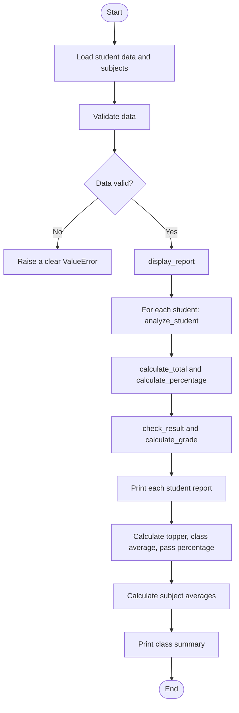

# Student Performance Analyzer

A Python case-study project focused on reusable functions, validation, and basic testing.

## Features

- Calculates each student's total and percentage
- Checks pass/fail using a per-subject passing threshold
- Assigns grades
- Finds the class topper
- Calculates class average and pass percentage
- Calculates subject-wise averages
- Validates student data and marks
- Includes unit tests using Python's built-in `unittest`

## Project structure

```text
student-performance-analyzer/
├── main.py
├── tests.py
└── README.md
```

## Requirements

Python 3.9+ recommended. No third-party packages are required.

## Run the application

```bash
python main.py
```

## Run tests

```bash
python -m unittest -v tests.py
```

## Flow diagram



## Business rules

- Every subject is out of 100.
- A student passes only if their mark in **every** subject is at least 33.
- Grade bands: A = 90+, B = 75–89.99, C = 60–74.99, D = 33–59.99, F = below 33.
- If a student fails any subject, the displayed overall grade is F.
- Class average is the mean of student percentages.
- Pass percentage is the share of students who pass all subjects.

## Suggested extensions

1. Read students from a CSV file.
2. Add a menu to search for a student by name.
3. Export the report to a CSV file.
4. Add sorting by percentage.
5. Add more tests for empty datasets and invalid student records.
